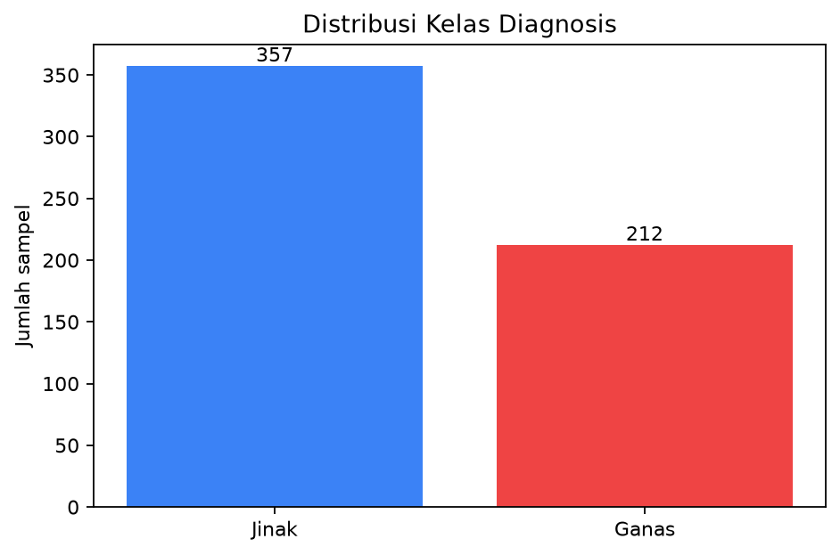
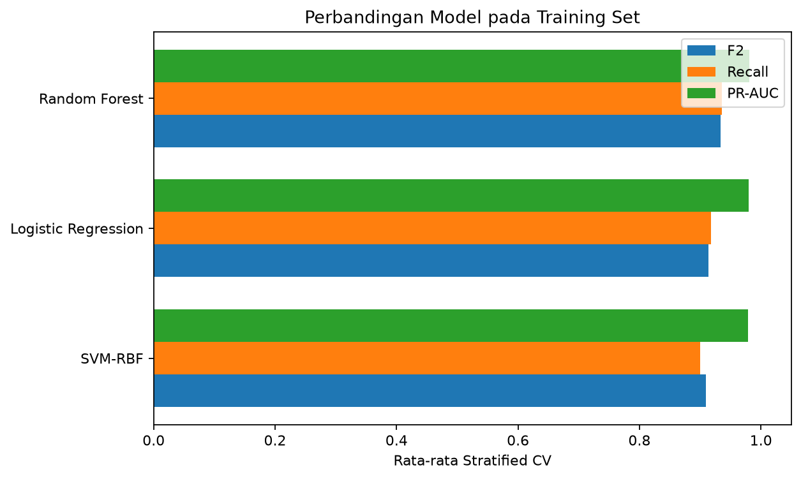
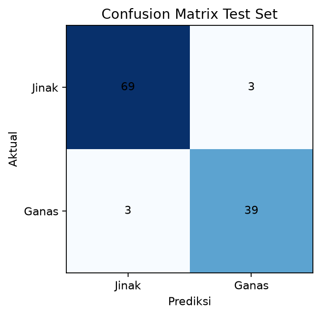
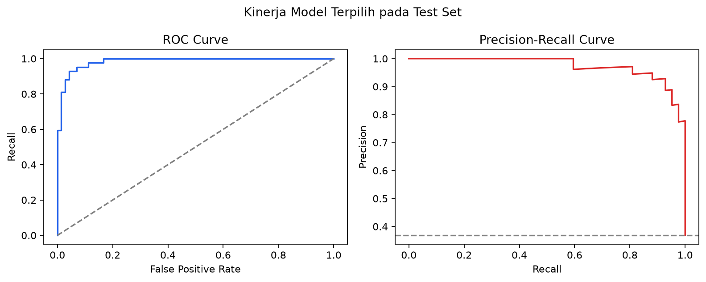
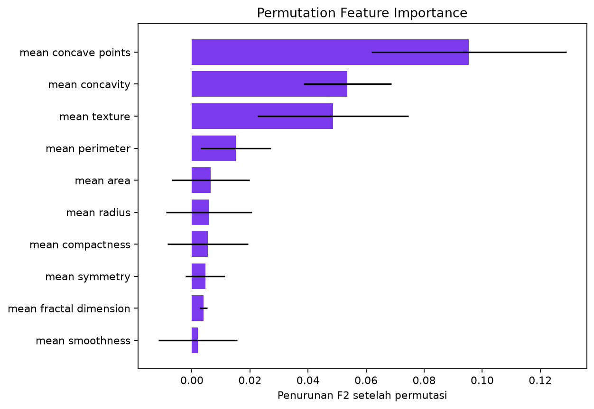
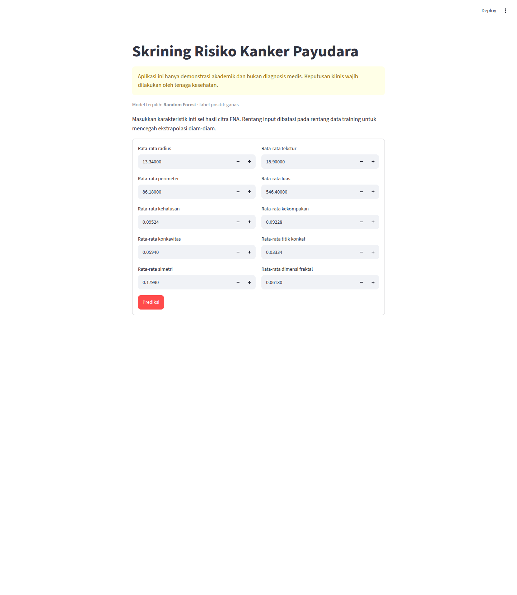

# Prediksi Keganasan Massa Payudara

## Mini Project Machine Learning End-to-End

**Durasi total:** ±12 menit  
**Disclaimer:** demonstrasi akademik, bukan diagnosis medis.

> **Catatan pembicara (30 detik):** Buka dengan tujuan proyek: bukan menggantikan dokter, tetapi mendemonstrasikan workflow ML yang jujur dari data sampai aplikasi.

---

# 1. Masalah dan Tujuan

- Klasifikasi massa payudara: ganas vs jinak.
- False negative lebih mahal daripada false positive.
- Metrik utama: F2; metrik pendamping: recall, F1, ROC-AUC, PR-AUC.
- Output: model reproducible + aplikasi Streamlit.

> **Catatan (1 menit):** Jelaskan bahwa recall menjawab “berapa kasus ganas aktual yang berhasil ditemukan.” Prioritas ini selaras dengan contoh skrining pada materi [ML-P07, hlm. 22].

---

# 2. CRISP-DM

1. Business Understanding
2. Data Understanding
3. Data Preparation
4. Modeling
5. Evaluation
6. Deployment

> **Catatan (45 detik):** Tekankan bahwa CRISP-DM bersifat iteratif, bukan checklist sekali jalan [ML-P02, hlm. 6].

---

# 3. Dataset

- Breast Cancer Wisconsin (Diagnostic), UCI.
- 569 observasi, 30 fitur asli, dua kelas.
- Proyek memakai 10 fitur `mean` agar deployment ringkas.
- 357 jinak (62,74%) dan 212 ganas (37,26%).
- Tidak ada missing value atau duplikasi.

> **Catatan (1 menit):** Sebutkan bahwa data berasal dari pengukuran inti sel pada citra FNA. Tandai UCI sebagai sumber luar knowledge base.

---

# 4. Data Preparation Anti-Leakage

- Label dibalik: `1 = ganas`.
- Split stratified 80:20, seed 42.
- Scaling hanya di dalam pipeline Logistic Regression/SVM.
- Class weight ikut dituning.
- Test set dikunci sampai model dipilih dari CV.

> **Catatan (1 menit):** Pipeline memastikan scaler di-fit hanya pada fold training, sesuai prinsip evaluasi jujur [ML-P07, hlm. 21]. Outlier tidak dihapus mekanis karena bisa merepresentasikan kasus penting.

---

# 5. Tiga Model dan Tuning

| Model | Fokus grid |
|---|---|
| Logistic Regression | C, class weight |
| SVM-RBF | C, gamma, class weight |
| Random Forest | tree, depth, split, class weight |

- GridSearchCV
- Stratified 5-Fold yang sama
- Refit berdasarkan F2

> **Catatan (1 menit):** Semua model mendapat split, fold, dan metrik yang sama agar perbandingan adil [ML-MODUL-01, hlm. 89–90].

---

# 6. Hasil Cross-Validation

| Model | F2 CV | Recall CV | PR-AUC CV |
|---|---:|---:|---:|
| Logistic Regression | 0,913 ± 0,021 | 0,918 | 0,980 |
| SVM-RBF | 0,909 ± 0,032 | 0,900 | 0,979 |
| **Random Forest** | **0,934 ± 0,021** | **0,935** | **0,981** |

> **Catatan (1,5 menit):** Random Forest dipilih sebelum melihat test karena F2 dan recall CV tertinggi. Parameter terbaik: 200 tree, depth 5, minimum split 5, balanced class weight.

---

# 7. Hasil Test Set

- Accuracy: **94,74%**
- Precision ganas: **92,86%**
- Recall ganas: **92,86%**
- F1/F2: **92,86%**
- ROC-AUC: **0,9848**
- PR-AUC: **0,9740**

> **Catatan (1,5 menit):** Baca confusion matrix: 69 TN, 3 FP, 3 FN, 39 TP. Jangan hanya menonjolkan accuracy—tiga kasus ganas masih terlewat.

---

# 8. Kurva dan Interpretasi

- Diskriminasi model tinggi.
- PR-AUC relevan untuk menilai kelas positif.
- Threshold 0,5 belum dioptimalkan secara klinis.

> **Catatan (1 menit):** Jika threshold diturunkan, recall berpotensi naik tetapi false positive juga bertambah [ML-P07, hlm. 22]. Threshold baru tidak boleh dipilih dari test set ini.

---

# 9. Fitur yang Berpengaruh

- `mean concave points`
- `mean concavity`
- `mean texture`

> **Catatan (45 detik):** Ini permutation importance terhadap F2, bukan bukti kausal atau interpretasi klinis.

---

# 10. Deployment Streamlit

- Model dan preprocessing dimuat dari satu bundle.
- Sepuluh input dibatasi ke rentang training.
- Output: kelas dan probabilitas ganas.
- Disclaimer medis selalu terlihat.

> **Catatan (1 menit):** Lakukan demo singkat: ubah satu-dua input, klik Prediksi, dan tunjukkan probabilitas. Deployment harus memakai pipeline yang sama dengan training [ML-MODUL-01, hlm. 90–93].

---

# 11. Keterbatasan

- Dataset kecil dan satu sumber.
- Belum ada validasi eksternal/klinis.
- Hanya 10 dari 30 fitur yang digunakan.
- Test set hanya 114 observasi.
- Tiga false negative masih terjadi.
- Belum ada monitoring drift atau audit fairness.

> **Catatan (1 menit):** Jangan menyamakan skor akademik tinggi dengan kesiapan klinis. Pengembangan berikutnya adalah validasi eksternal, threshold validation, calibration audit, dan monitoring.

---

# 12. Kesimpulan

- Workflow Bab 14 selesai end-to-end.
- Random Forest unggul pada F2 dan recall CV.
- Test recall ganas 92,86%, tetapi bukan 100%.
- Pipeline reproducible dan aplikasi siap didemokan.
- **Model bukan diagnosis medis.**

> **Catatan (45 detik):** Tutup dengan satu pesan: proyek yang baik bukan sekadar skor tinggi, tetapi evaluasi jujur, keterbatasan transparan, dan deployment yang konsisten.

---

# Sumber

- Materi: [ML-MODUL-01, hlm. 89–94], [ML-P02, hlm. 6–12], [ML-P07, hlm. 19–24].
- **Sumber luar:** UCI Breast Cancer Wisconsin (Diagnostic), DOI 10.24432/C5DW2B.
- **Sumber luar:** scikit-learn `load_breast_cancer`.

