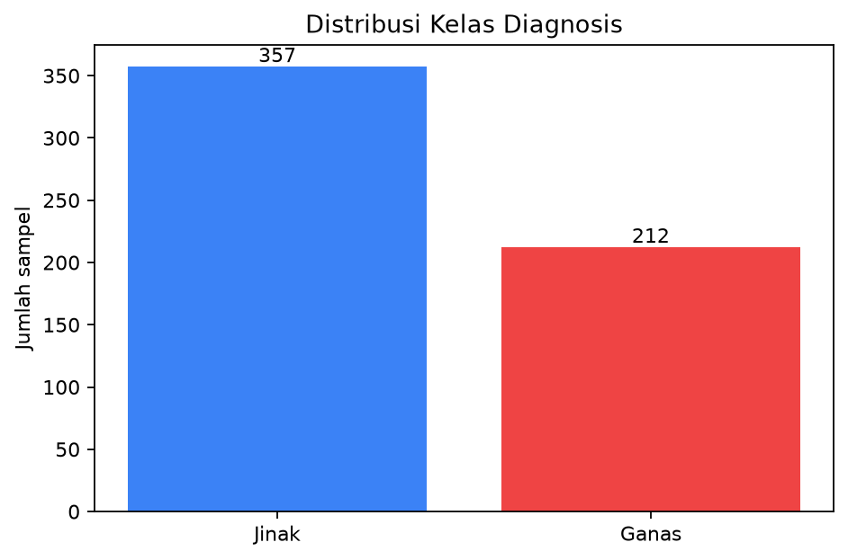
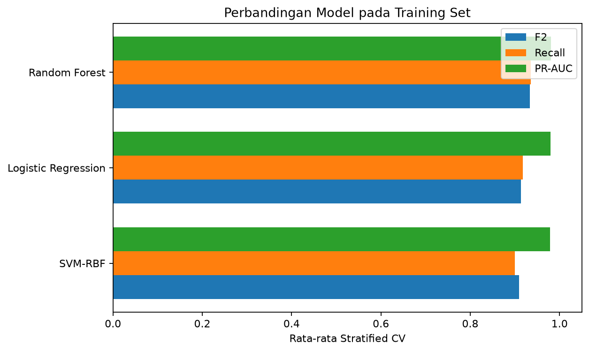
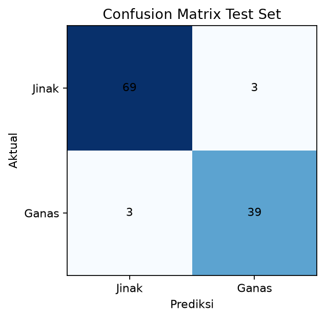
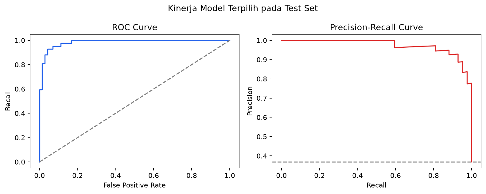
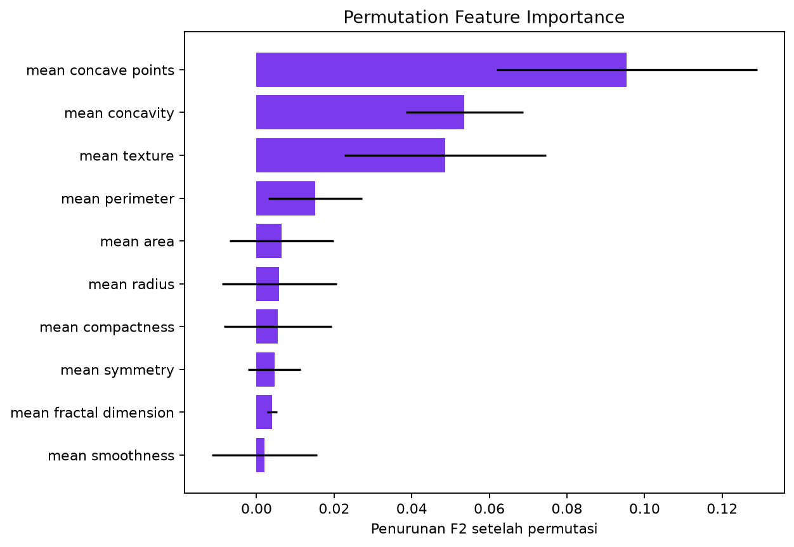
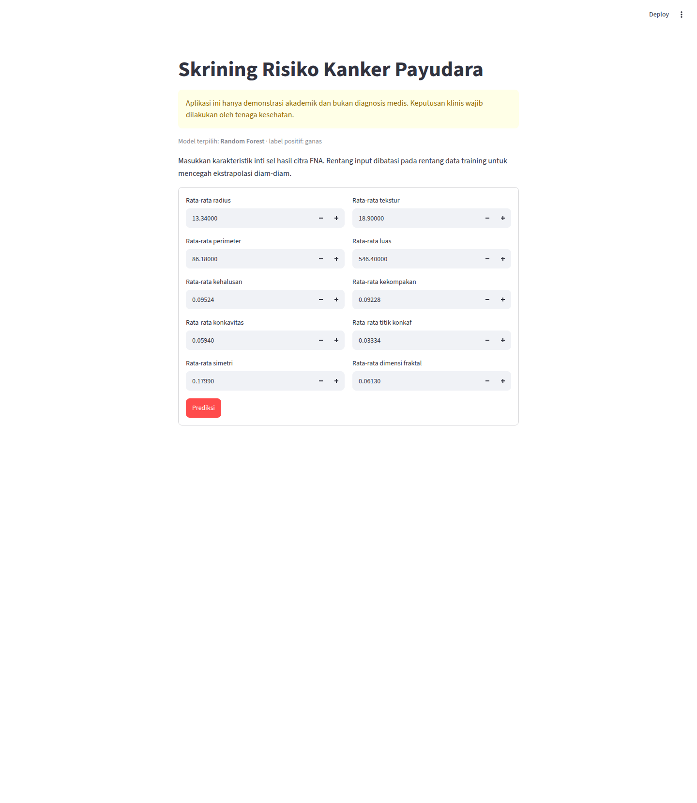

# Laporan Mini Project End-to-End

## Prediksi Keganasan Massa Payudara dengan Komparasi dan Tuning Model

**Mata kuliah:** Machine Learning  
**Bab:** 14 — Mini Project End-to-End  
**Seed eksperimen:** 42

> **Batas penggunaan:** seluruh hasil dalam proyek ini adalah demonstrasi akademik. Model belum divalidasi secara klinis dan bukan diagnosis medis maupun pengganti keputusan tenaga kesehatan.

## Ringkasan Eksekutif

Proyek ini mengklasifikasikan massa payudara sebagai ganas atau jinak dari sepuluh karakteristik rata-rata inti sel pada citra fine needle aspirate (FNA). Alur proyek mengikuti enam fase CRISP-DM dan requirement Bab 14: EDA, preprocessing, perbandingan minimal tiga algoritma, tuning, evaluasi, dan deployment [ML-MODUL-01, hlm. 89–94].

Logistic Regression, SVM-RBF, dan Random Forest dituning memakai split yang sama serta Stratified 5-Fold CV. Label ganas dijadikan kelas positif. F2 dipilih sebagai metrik seleksi karena memberi bobot lebih besar pada recall—false negative berarti massa ganas diprediksi jinak. Random Forest memperoleh F2 CV tertinggi, yaitu **0,934 ± 0,021**, sehingga dikunci sebagai model final sebelum test set dibuka. Pada 114 observasi test, model menghasilkan accuracy **94,74%**, recall ganas **92,86%**, F1 **92,86%**, ROC-AUC **0,9848**, dan PR-AUC **0,9740**. Terdapat tiga false negative dari 42 kasus ganas.

## 1. Pendahuluan dan Business Understanding

CRISP-DM menjaga proyek tetap terarah dan iteratif melalui Business Understanding, Data Understanding, Data Preparation, Modeling, Evaluation, dan Deployment [ML-P02, hlm. 6]. Proyek ML seharusnya dimulai dari keputusan dan ukuran keberhasilan, bukan dari algoritma yang ingin dicoba [ML-P02, hlm. 7].

### 1.1 Masalah

Tujuan teknis proyek adalah membantu demonstrasi penyaringan awal: berdasarkan pengukuran inti sel dari FNA, model memperkirakan apakah massa lebih menyerupai kelas ganas atau jinak. Dalam konteks ini, kesalahan false negative lebih berat daripada false positive karena kasus ganas yang terlewat dapat menunda pemeriksaan lanjutan. Materi kuliah juga mencontohkan skrining kanker sebagai konteks yang memprioritaskan recall [ML-P07, hlm. 22].

### 1.2 Sasaran terukur

- Metrik seleksi utama: F2 rata-rata Stratified 5-Fold CV.
- Metrik pendamping: recall, precision, F1, ROC-AUC, dan PR-AUC.
- Target operasional akademik: membandingkan tiga algoritma secara adil, mengunci pemenang berdasarkan CV training, lalu melaporkan performa final pada test set satu kali.
- Output: model terserialisasi dan aplikasi Streamlit dengan sepuluh input tervalidasi.

## 2. Data Understanding

### 2.1 Sumber dan karakteristik

**Sumber luar knowledge base:** Breast Cancer Wisconsin (Diagnostic) dari UCI Machine Learning Repository, dibuat oleh Wolberg, Mangasarian, Street, dan Street; DOI `10.24432/C5DW2B`. Salinan dataset dimuat lewat `sklearn.datasets.load_breast_cancer`. Menurut halaman resmi UCI, fitur dihitung dari citra digital FNA dan menggambarkan karakteristik inti sel. Dataset memiliki 569 observasi, 30 fitur numerik kontinu, serta dua kelas. Tautan: <https://archive.ics.uci.edu/dataset/17/breast+cancer+wisconsin+diagnostic> dan <https://scikit-learn.org/stable/modules/generated/sklearn.datasets.load_breast_cancer.html>.

Distribusi label setelah pemetaan proyek adalah 357 jinak (62,74%) dan 212 ganas (37,26%). Dataset tidak memiliki missing value dan tidak ditemukan baris duplikat pada kombinasi sepuluh fitur terpilih plus target.

### 2.2 Fitur yang digunakan

Sepuluh fitur `mean` dipilih *a priori* agar form deployment tetap masuk akal dan seleksi tidak menggunakan informasi test: `mean radius`, `mean texture`, `mean perimeter`, `mean area`, `mean smoothness`, `mean compactness`, `mean concavity`, `mean concave points`, `mean symmetry`, dan `mean fractal dimension`. Statistik lengkap tersedia pada `artifacts/feature_summary.csv`.

EDA harus memeriksa distribusi, missing value, duplikasi, nilai tidak logis, outlier, konteks baris, dan risiko leakage; EDA bukan sekadar membuat grafik [ML-P02, hlm. 8]. Dengan aturan IQR 1,5, terdapat 139 sel terindikasi outlier yang tersebar pada 67 baris. Observasi tersebut tidak dihapus karena nilai masih berada dalam domain dataset sumber, ukuran dataset terbatas, dan penghapusan mekanis berisiko membuang kasus klinis penting. Sebagai mitigasi, fitur diskalakan untuk Logistic Regression/SVM dan Random Forest ikut dibandingkan karena tidak sensitif terhadap skala dengan cara yang sama.

## 3. Data Preparation

Materi menekankan urutan aman: split lebih awal, kemudian imputer/encoder/scaler hanya di-fit pada training; validation dan test hanya ditransformasi [ML-P02, hlm. 9]. Implementasi proyek menerapkan langkah berikut:

1. Target asli scikit-learn (`0=malignant`, `1=benign`) dibalik menjadi `1=ganas` dan `0=jinak`, supaya recall/F2 secara eksplisit mengukur kasus ganas.
2. Data dibagi 80% training (455 baris) dan 20% test (114 baris) dengan `stratify=y` dan `random_state=42`.
3. Tidak ada imputasi karena missing value berjumlah nol.
4. Sepuluh fitur dipilih sebelum modeling berdasarkan kelompok fitur `mean`, bukan berdasarkan korelasi terhadap target.
5. `StandardScaler` ditempatkan di dalam pipeline Logistic Regression dan SVM. Random Forest tetap berada di dalam pipeline tanpa scaler.
6. Ketidakseimbangan kelas ditangani melalui stratifikasi dan kandidat `class_weight="balanced"` di grid, bukan oversampling sebelum CV.

Stratified K-Fold mempertahankan proporsi kelas pada tiap fold [ML-P07, hlm. 19]. Menempatkan preprocessing di dalam pipeline mencegah informasi fold validation bocor ke proses scaling [ML-P07, hlm. 21].

## 4. Modeling dan Hyperparameter Tuning

Kompleksitas model harus dibenarkan oleh peningkatan generalisasi; tuning dilakukan pada validation/CV, bukan test [ML-P02, hlm. 10]. Ketiga kandidat memakai Stratified 5-Fold yang identik, shuffle aktif, dan seed 42.

| Model | Grid utama |
|---|---|
| Logistic Regression | `C={0.01,0.1,1,10}`, `class_weight={None,balanced}` |
| SVM-RBF terkalibrasi | `C={0.1,1,10}`, `gamma={scale,0.01,0.1}`, `class_weight={None,balanced}` |
| Random Forest | `n_estimators={200,400}`, `max_depth={None,5,10}`, `min_samples_split={2,5}`, `class_weight={None,balanced}` |

`GridSearchCV` melakukan refit berdasarkan F2. SVM dibungkus `CalibratedClassifierCV` agar probabilitas dapat dipakai untuk ROC-AUC/PR-AUC tanpa memakai mode probabilitas SVC yang sudah deprecated pada scikit-learn 1.9.

## 5. Evaluation

Rata-rata dan standar deviasi antar-fold melaporkan level sekaligus stabilitas model [ML-P07, hlm. 20]. Test set disimpan untuk evaluasi final dan tidak digunakan untuk memilih algoritma atau hyperparameter, sesuai protokol evaluasi jujur [ML-P07, hlm. 21–23].

### 5.1 Hasil cross-validation pada training set

| Model | F2 CV | Recall CV | Precision CV | F1 CV | ROC-AUC CV | PR-AUC CV |
|---|---:|---:|---:|---:|---:|---:|
| Logistic Regression | 0,913 ± 0,021 | 0,918 | 0,897 | 0,907 | **0,985** | 0,980 |
| SVM-RBF | 0,909 ± 0,032 | 0,900 | **0,951** | 0,924 | 0,985 | 0,979 |
| **Random Forest** | **0,934 ± 0,021** | **0,935** | 0,931 | **0,933** | 0,984 | **0,981** |

Random Forest dipilih karena F2 dan recall CV tertinggi, PR-AUC tertinggi, serta variasi antar-fold rendah. Logistic Regression memiliki ROC-AUC sedikit lebih tinggi, tetapi selisih tersebut tidak mengalahkan prioritas proyek pada F2/recall. Parameter terbaik Random Forest adalah 200 tree, `max_depth=5`, `min_samples_split=5`, dan `class_weight="balanced"`.

### 5.2 Evaluasi final pada test set

| Metrik | Nilai |
|---|---:|
| Accuracy | 0,9474 |
| Precision ganas | 0,9286 |
| Recall ganas | 0,9286 |
| F1 | 0,9286 |
| F2 | 0,9286 |
| ROC-AUC | 0,9848 |
| PR-AUC | 0,9740 |

Confusion matrix menghasilkan TN=69, FP=3, FN=3, dan TP=39. Artinya 39 dari 42 kasus ganas terdeteksi; tiga kasus ganas terlewat. Recall mengukur proporsi kasus positif aktual yang ditemukan, yaitu `TP/(TP+FN)` [ML-P07, hlm. 9]. F1 menyeimbangkan precision dan recall [ML-P07, hlm. 10], sedangkan F2 pada proyek ini memberi bobot recall lebih besar.

Permutation importance menunjukkan `mean concave points` sebagai fitur dengan kontribusi F2 paling besar, diikuti `mean concavity` dan `mean texture`. Importance ini menjelaskan sensitivitas prediktif model pada dataset, bukan hubungan sebab-akibat klinis.

## 6. Deployment

Bab 14 menyarankan menyimpan seluruh pipeline dengan `joblib`, memuatnya kembali pada aplikasi, menerima input pengguna, dan menjalankan `model.predict()` melalui preprocessing yang sama [ML-MODUL-01, hlm. 90–91]. Proyek menyimpan `artifacts/model_bundle.joblib` yang berisi model, urutan sepuluh fitur, rentang/median training, mapping kelas, dan metrik final.

Aplikasi `app.py`:

- menampilkan sepuluh `number_input` dengan batas minimum–maksimum training;
- menolak kolom hilang/asing, non-numerik, nilai non-finite, dan nilai di luar rentang;
- menampilkan kelas prediksi serta probabilitas ganas;
- selalu menampilkan peringatan bahwa hasil bukan diagnosis medis.

Jalankan aplikasi dengan `.venv/bin/streamlit run app.py`.

## 7. Keterbatasan, Risiko, dan Pengembangan

1. Dataset kecil dan berasal dari satu sumber; skor internal tidak membuktikan generalisasi lintas rumah sakit atau populasi.
2. Sepuluh fitur yang dipakai adalah subset untuk kemudahan deployment akademik; performa bisa berbeda bila memakai 30 fitur.
3. Test set hanya 114 observasi sehingga estimasi metrik masih memiliki ketidakpastian.
4. Threshold default 0,5 belum dioptimalkan untuk kebijakan klinis. Penurunan threshold dapat meningkatkan recall tetapi menambah false positive [ML-P07, hlm. 22]. Threshold baru harus dipilih memakai validation/CV terpisah, bukan test saat ini.
5. Input dibatasi pada rentang training, tetapi pembatasan ini belum mendeteksi kombinasi fitur yang tidak realistis.
6. Deployment produksi memerlukan validasi eksternal, audit fairness, kalibrasi berkala, keamanan data, monitoring drift, dan pengawasan klinisi. Poin ini memakai **pengetahuan umum di luar knowledge base**.

## 8. Kesimpulan

Mini project memenuhi alur CRISP-DM end-to-end dan requirement Bab 14. Dari tiga kandidat yang dibandingkan secara konsisten, Random Forest terpilih berdasarkan F2 CV tertinggi. Hasil test menunjukkan performa diskriminasi tinggi, tetapi masih terdapat tiga false negative sehingga model tidak layak dianggap sebagai alat diagnosis. Nilai utama proyek adalah pipeline yang reproducible, evaluasi anti-leakage, pelaporan transparan, dan deployment sederhana yang konsisten dengan model training.

## Referensi

### Materi kuliah utama

- `[ML-MODUL-01, hlm. 89–94]` — struktur mini project, komparasi, tuning, deployment, laporan, dan instruksi proyek utama.
- `[ML-P02, hlm. 6–12]` — fase CRISP-DM, pencegahan leakage, modeling, evaluation, dan deployment.
- `[ML-P07, hlm. 9–10, 19–24]` — recall, F1, Stratified K-Fold, evaluasi anti-leakage, threshold skrining, dan laporan evaluasi.

### Sumber luar knowledge base

- Wolberg, W., Mangasarian, O., Street, N., & Street, W. (1993). *Breast Cancer Wisconsin (Diagnostic)*. UCI Machine Learning Repository. <https://doi.org/10.24432/C5DW2B>.
- Scikit-learn. *load_breast_cancer documentation*. <https://scikit-learn.org/stable/modules/generated/sklearn.datasets.load_breast_cancer.html>.

