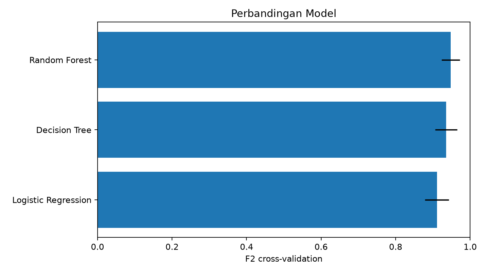
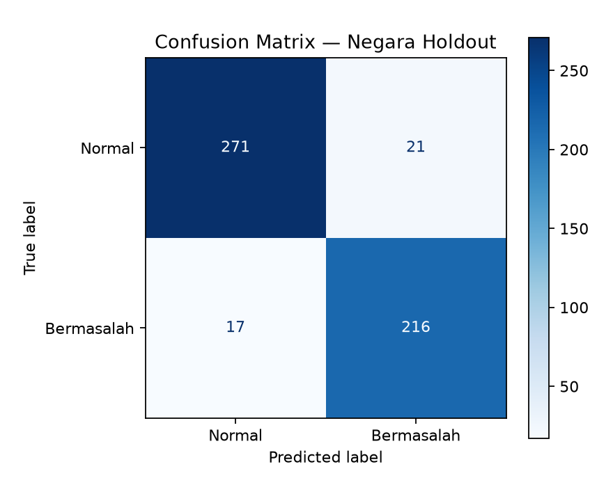

# Laporan Ringkas Mini Project Bab 14 v2

## 1. Business Understanding

Tujuan proyek adalah memprediksi apakah kondisi jaringan suatu negara-bulan tergolong **normal** atau mengalami **gangguan berat**. Aplikasi ditujukan sebagai demonstrasi akademik untuk membantu membaca hubungan bandwidth, latensi, dan packet loss—bukan sebagai alat diagnosis koneksi pelanggan.

Alur proyek mengacu pada tugas mini project Bab 14: memilih dataset, mengikuti CRISP-DM, membandingkan minimal tiga model, melakukan tuning dan cross-validation, mengevaluasi model, lalu menyiapkan deployment. [ML-MODUL-01, hlm. 89–91]

## 2. Data Understanding

Sumber data adalah M-Lab Monthly Stats tahun 2025 pada tingkat negara-bulan. Setelah syarat minimal 100 sampel diterapkan, tersedia:

- 2.534 observasi;
- 227 negara;
- 12 bulan;
- 1.256 label normal dan 1.278 label bermasalah.

Fitur yang digunakan adalah median (`p50`) download, latensi, dan packet loss. Label tidak diambil langsung dari ketiga fitur tersebut. Label gangguan berat dibuat dari `p75`: bila bahkan kuartil performa yang lebih baik gagal salah satu ambang 25 Mbps, 50 ms, atau packet loss 0,5%, observasi diberi label bermasalah.

## 3. Data Preparation

Baris dengan nilai hilang, tak hingga, nilai fisik tidak masuk akal, atau jumlah sampel di bawah 100 dibuang. Data dipisahkan berdasarkan negara, bukan secara acak per baris. Hasilnya 181 negara untuk training dan 46 negara untuk test, dengan **0 negara tumpang tindih**. Strategi ini mencegah observasi negara yang sama pada bulan lain membocorkan pola ke test set.

## 4. Modeling

Tiga algoritma dibandingkan menggunakan 5-fold `StratifiedGroupKFold` dan grid search:

| Model | F2 CV | Recall CV | PR-AUC CV |
|---|---:|---:|---:|
| Logistic Regression | 0,910 | 0,907 | 0,958 |
| Decision Tree | 0,935 | 0,946 | 0,950 |
| Random Forest | **0,948** | **0,957** | **0,970** |

F2 dijadikan metrik pemilihan agar kesalahan melewatkan kondisi bermasalah mendapat bobot lebih besar daripada false alarm. Random Forest terpilih dengan 300 pohon, kedalaman maksimum 5, minimal 5 sampel per daun, dan class weight seimbang.

## 5. Evaluation

Evaluasi akhir hanya dilakukan pada 525 observasi dari 46 negara holdout:

| Metrik | Nilai |
|---|---:|
| Accuracy | 0,928 |
| Precision | 0,911 |
| Recall | 0,927 |
| F1 | 0,919 |
| F2 | 0,924 |
| ROC-AUC | 0,969 |
| PR-AUC | 0,947 |

Confusion matrix menghasilkan 271 true negative, 216 true positive, 21 false positive, dan 17 false negative.

## 6. Deployment

Model dan metadata disimpan dalam `artifacts/model_bundle.joblib`. `app.py` menyediakan tiga input dengan validasi sesuai rentang training dan menampilkan label serta probabilitas. Notebook Colab menjalankan seluruh proses dari unduh data sampai evaluasi.

## 7. Keterbatasan

- Data bersifat agregat negara-bulan dan tidak mewakili satu pelanggan.
- Target adalah weak label berbasis threshold, bukan tiket gangguan nyata.
- Model belum memakai upload, jitter, rute jaringan, sinyal Wi-Fi, atau kondisi perangkat.
- Performa holdout yang baik tidak menjamin generalisasi ke pengukuran real-time individual.
